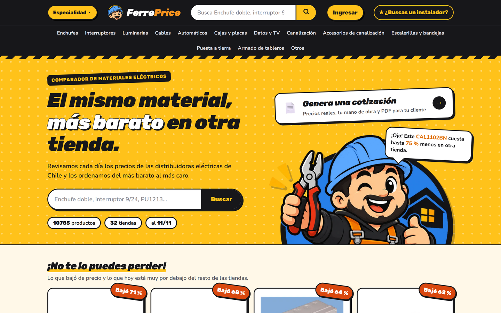
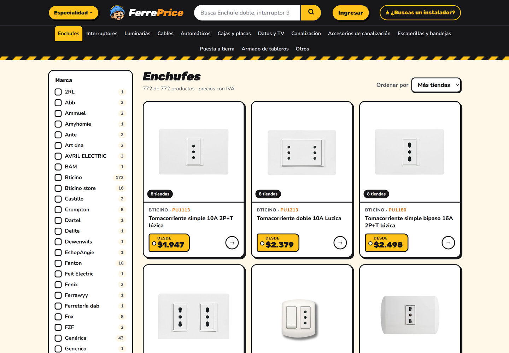
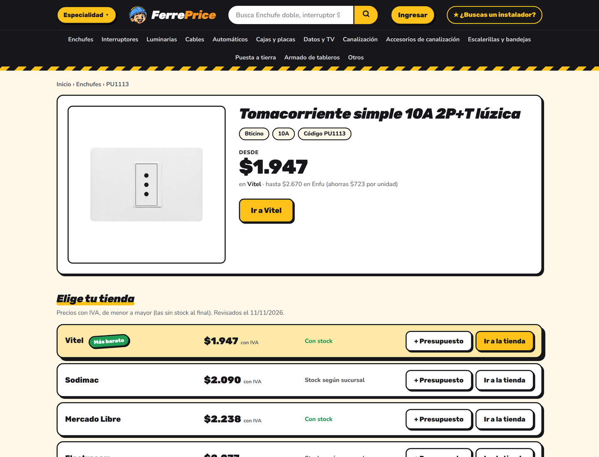
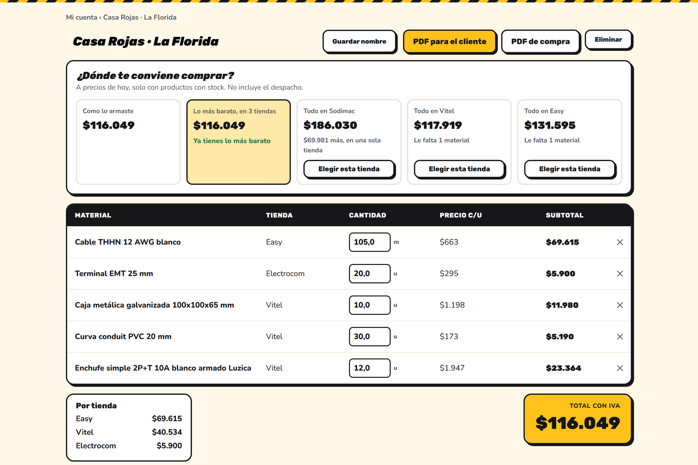
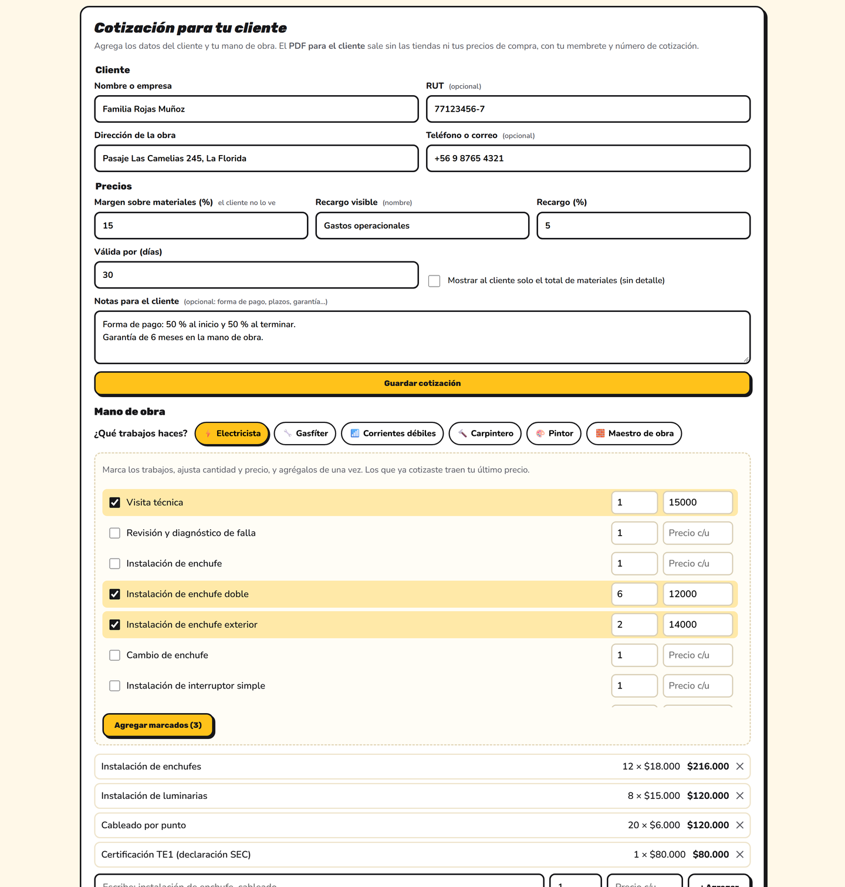
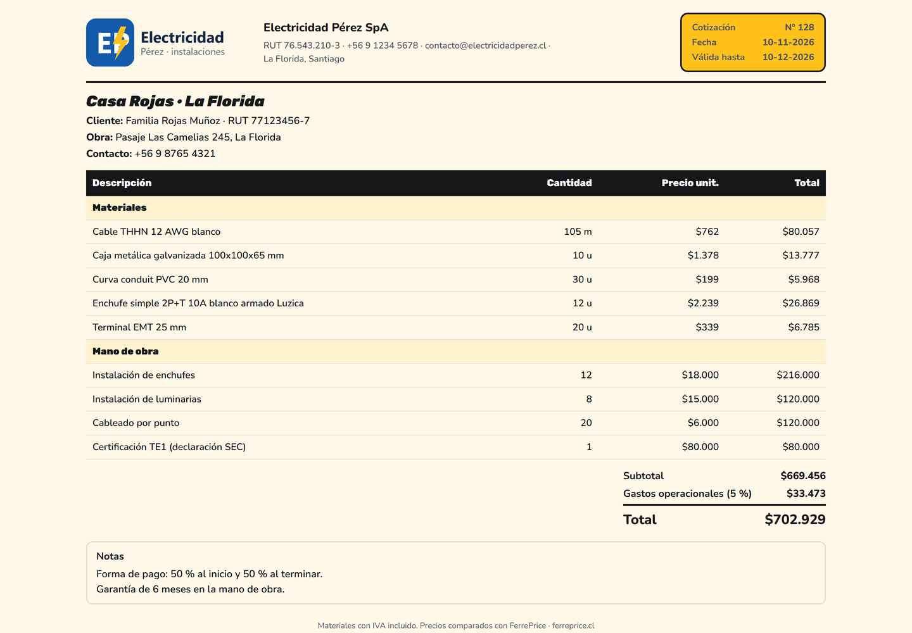

# FerrePrice

**Comparador de precios de materiales de construcción en Chile**: el mismo material, ordenado del más barato al más caro entre las distribuidoras y ferreterías del país, con presupuestos y cotizaciones automáticas para instaladores.

Producto propio, en producción, con cuentas de usuario, pago real integrado y precios actualizados todos los días: [ferreprice.cl](https://ferreprice.cl). Lo construí desde cero en noviembre de 2026, a partir de un problema que conozco por mis 10 años de electricista: cotizar materiales tienda por tienda para cada presupuesto.

Este repositorio muestra cómo está construido, con qué tecnologías y qué hace. El código fuente no está incluido (ver [Licencia](#licencia)).

---

## En números

| | |
|---|---|
| Tiendas comparadas | **55** distribuidoras y ferreterías |
| Productos comparados | **más de 31.000** |
| Especialidades | **6**: Electricidad, Gasfitería, Corrientes débiles, Carpintería, Pintura y Obra gruesa |
| Páginas en Google | **más de 31.000** en el mapa del sitio |

---

## Capturas de pantalla

### Portada

Buscador por nombre o código del fabricante, especialidades y productos que bajaron de precio. Los números de la portada son los de la especialidad elegida (aquí, Electricidad).



### Categorías con filtros

Cada categoría filtra por marca, línea y características, y muestra en cuántas tiendas está cada producto.



### Comparar precios

El mismo producto en todas las tiendas, ordenado del más barato al más caro, con stock y el ahorro frente a la más cara.



### ¿Dónde te conviene comprar?

Sobre cada presupuesto: lo armado, lo más barato repartido en varias tiendas y todo en una sola tienda, con cuánto se ahorra.



### Cotización para el cliente

Datos del cliente, margen sobre materiales (que el cliente no ve) y mano de obra: el instalador elige sus oficios y marca los trabajos típicos.



### PDF para el cliente

Con el logo y los datos del instalador, número de cotización y validez, sin las tiendas ni los precios de compra.



---

## Lenguaje y plataforma

| | |
|---|---|
| Lenguaje | **C#**, **HTML**, **CSS** y **JavaScript** sin frameworks |
| Plataforma | **.NET 10** |
| Sitio | **ASP.NET Core Razor Pages** y Minimal APIs |
| Datos | **SQLite** con **Entity Framework Core** (catálogo y cuentas en bases separadas) y archivos JSON |
| Entrega | **Docker** en un VPS con **Dokploy** y **Traefik** (HTTPS con Let's Encrypt), despliegue automático desde GitHub |

Composición del repositorio privado: C# 65 %, HTML (vistas Razor) 25 %, CSS 10 %.

### Servicios integrados

| Servicio | Uso |
|---|---|
| Google | Inicio de sesión con OAuth |
| Flow.cl | Pagos en línea (Plan Pro y fichas de instalador), con boleta o factura |
| Resend | Correos: confirmación de cuenta, pagos, recordatorios |
| Google Search Console | Mapa del sitio y robots, generados por el propio sitio |

---

## Arquitectura

```
Catálogo de precios (SQLite, actualizado a diario)
          |
Sitio (ASP.NET Core Razor Pages)  ──>  Usuarios: comparar, presupuestos, cotizaciones, instaladores
          |
          └─ Panel de administración: tiendas, cuentas, pagos, instaladores, publicidad y visitas
```

### Decisiones técnicas destacables

- **El cliente final no ve el costo**: la cotización aplica el margen del instalador sobre los materiales y el PDF para el cliente sale sin tiendas ni precios de compra.
- **Pagos reales integrados**: el Plan Pro y las fichas de instalador se pagan en línea con Flow, con boleta o factura, y se activan solos al confirmarse el pago.
- **Confianza en los instaladores**: el sello de seguridad se da solo después de revisar la licencia o el certificado, y el documento se borra apenas se revisa.
- **Visitas sin seguimiento**: se cuentan personas por día con un código diario derivado de la IP y el navegador, sin guardar la IP ni usar cookies de seguimiento.
- **Secretos fuera del código**: las credenciales de producción viven solo en el entorno del servidor.

---

## Funcionalidades

- **Comparar**: el mismo material en todas las tiendas, con stock, ahorro y productos que bajaron de precio.
- **Presupuestos**: materiales por tienda y cantidad, total por tienda, aviso cuando cambian los precios y «¿Dónde te conviene comprar?».
- **Cotizaciones**: cliente, margen oculto, recargo visible, mano de obra por oficio, validez, notas y PDF con membrete y número correlativo.
- **Cuenta gratis y Plan Pro**: una cotización en PDF al mes gratis; ilimitadas con el Plan Pro, pagado con Flow.
- **Instaladores**: fichas pagadas por comuna con contacto directo por WhatsApp, y **sello de seguridad** tras revisar la licencia o el certificado del instalador.
- **Publicidad**: estandartes por especialidad, con fechas y conteo de clics.
- **Panel de administración**: tiendas, cuentas, pagos, instaladores, publicidad y visitas.

---

## Autor

**Bladimir López** — Ingeniero Informático y electricista  
Terreno Digital SpA · [ferreprice.cl](https://ferreprice.cl) · contacto@terrenodigital.cl

## Licencia

Material informativo. El código fuente de FerrePrice es propietario y no forma parte de este repositorio. Ver [LICENSE](LICENSE).
